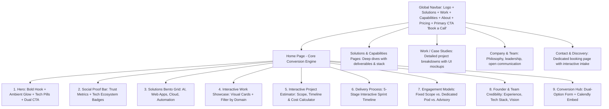
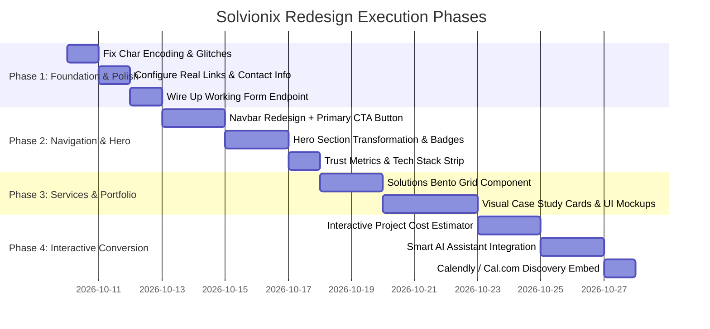

# Solvionix Strategic Redesign & Architectural Transformation Plan

## 1. Executive Summary & Vision

**Solvionix** is positioned as an AI, Software, and Business Solutions agency (*"Turning business problems into technology solutions"*). 

Currently, the website has an austere, highly editorial, and text-heavy structure with an abstract circuit-flow animation hero. While the tone is articulate and rigorous, **it suffers from conversion and aesthetic friction common to early-stage agency sites**:
- No immediate visual proof of work (no device mockups, UI screenshots, or interactive demos).
- The primary Call-to-Action (CTA) is tucked away in a small floating corner button.
- The lead capture form lacks budget qualification and calendar booking.
- The chatbot relies on a basic keyword-matching array rather than real generative intelligence.
- The typography and color palette lean dark and monochrome with minimal high-contrast visual hooks.

### The Target Benchmark: "Modern Engineering Studio"
Top-tier agency benchmarks (such as **Metalab**, **Fueled**, **Linear/Vercel** design ecosystems, and **Work & Co**) balance **rigorous engineering credibility** with **irresistible visual polish, rapid social proof, and seamless conversion funnels**.

---

## 2. Competitive Agency Benchmark: What Elite Agency Sites Feature

| Dimension | Elite Tech & AI Agencies (Metalab, Fueled, Vercel Partners) | Current Solvionix State | What Solvionix Needs |
| :--- | :--- | :--- | :--- |
| **Hero Section** | Bold value hook + dual CTAs (*"Book a Call"* / *"View Case Studies"*) + client ticker/rating badge. | Abstract circuit diagram + long text paragraphs + no visible CTA button in navbar or hero. | **High-impact Hero** with dynamic ambient glow, interactive tech/metric pills, and clear Dual CTA. |
| **Portfolio / Work** | High-res device mockups (laptop/mobile frames), video screen recordings, live URLs, measurable KPIs (*"+42% conversion, 2.4s to 0.4s load"*). | Generic abstract text descriptions labeled "Demonstration" with `liveUrl: null`, no images or mockups. | **Visual Case Study Showcase** with realistic product UI cards, live demo links, tag filters, and outcome statistics. |
| **Service Matrix** | Interactive accordion/tabs categorizing capabilities (AI Solutions, Custom Web Apps, Mobile, Integrations). | Long vertical text rows spread across separate sub-pages. | **Interactive Solutions Hub**: Bento grid or tabbed service cards highlighting tech stack pills and client deliverables. |
| **Engagement & Pricing** | Transparent engagement models (*Sprint-based, Fixed Scope, Dedicated Pod*) + Interactive Cost Estimator. | No pricing guidance; quote calculator is only a text case study. | **Interactive Project Cost & Scope Estimator** where clients can select project type, features, and timeline to get instant estimates. |
| **Conversion Funnel** | Multi-step interactive form + Direct **Calendly / Cal.com** calendar booking embed + instant WhatsApp. | 1-page form in demo mode (no backend); WhatsApp and email unconfigured (`null`). | **Dual-Funnel Conversion**: Live form submission (Formspree/Resend) + 1-click **Book a 15-Min Discovery Call** calendar modal. |
| **AI Assistant** | Real LLM-powered interactive assistant answering FAQs, scoping projects, and capturing lead emails. | Hardcoded dictionary matcher (`chatbotEngine.js`) that breaks on open-ended queries. | **Smart Gemini 2.5 Assistant**: Context-aware AI trained on Solvionix capabilities, able to qualify leads on the fly. |
| **Social Proof & Trust** | Client testimonial carousel, founder credentials, technology partner badges (AWS, Stripe, Google Cloud), security badges (GDPR, SOC2 compliance). | Single team member with no photo, no client reviews, no partner badges. | **Trust & Social Proof Section**: Client endorsements, security compliance standards, and tech ecosystem badges. |

---

## 3. Proposed Information Architecture (Site Map)

---

## 4. Section-by-Section Redesign Specifications

### Section 1: The Modernized Header & Hero
- **Navbar**:
  - Left: Refined Solvionix logo with glowing accent dot.
  - Center: Clean menu with subtle hover pills (`Solutions`, `Work`, `Process`, `About`, `Pricing`).
  - Right: Theme toggle + **High-Contrast Primary Button**: `"Book a Call"` (triggers discovery modal or scrolls to intake).
- **Hero Content**:
  - **Badge**: *“Engineering AI & Scalable Digital Products”* with subtle pulsating radar ping.
  - **Main Headline**: Modern typography (Inter Display / Outfit) with gradient text clip:
    > **"We turn complex business challenges into high-performance software & AI."**
  - **Subheadline**: Crisp 2-sentence value proposition emphasizing velocity, ownership, and measurable ROI.
  - **Action Hub**:
    - Primary CTA: *“Start a Project →”* (opens multi-step intake).
    - Secondary CTA: *“Explore Our Work”* (smooth scroll to visual showcase).
  - **Hero Right / Visual**: Modern 3D or layered Glassmorphic Interface preview with floating telemetry cards (*"API Response: 18ms"*, *"AI Grounding: 99.4%"*, *"99.99% Uptime"*).

---

### Section 2: Trust Metrics & Tech Ecosystem Strip
- **Proof Counters**:
  - **100%** Code Ownership & Zero Vendor Lock-in
  - **99.9%** Uptime Architecture Standard
  - **2–4 Weeks** Rapid MVP Delivery Sprint
  - **Enterprise-grade** Security & Clean Code
- **Tech Ecosystem Logos**: React, Python, Django, Node.js, PostgreSQL, Docker, AWS, Gemini API, Tailwind CSS.

---

### Section 3: Solutions & Services Bento Grid
Replace the long single-column list with a **visual Bento Grid**:
1. **Intelligent AI & Automation**: Custom LLM agents, document intelligence, RAG search systems.
2. **Digital Platforms & Web Apps**: Scalable SaaS platforms, customer portals, responsive React/Next apps.
3. **Internal Tools & Business Systems**: CRM engines, inventory synchronizers, operations dashboards.
4. **Cloud, APIs & Connected Infrastructure**: High-throughput REST/GraphQL APIs, microservices, secure webhooks.
*Each card features live interactive hover effects, key tech tags, and a "View Architecture" expander.*

---

### Section 4: Visual Work & Case Studies Showcase
- **Card Design**:
  - High-fidelity visual mockup of the application interface (browser window mockup / mobile frame).
  - Domain badge (e.g. `Healthcare`, `Fintech`, `Multi-channel Commerce`).
  - Key Result metrics highlighted in emerald/cyan pills.
  - Deliverables listed cleanly: `Architecture`, `Frontend`, `API & DB`, `Cloud Deploy`.
  - Links: `Live Demo` or `Case Study Breakdown →`.

---

### Section 5: The Interactive Project Estimator (High Conversion Driver)
A self-serve interactive calculator that lets prospective clients estimate their project:
1. **Select Type**: (Web App, Mobile App, AI Agent / Automation, System Integration).
2. **Select Scope**: (MVP / Prototype, Full Production Build, System Overhaul).
3. **Select Timeline**: (Urgent: 2-4 weeks, Standard: 6-10 weeks, Flexible).
4. **Estimated Range**: Displays expected turnaround and sprint requirements, with a direct button to **"Submit This Scope for Review"**.

---

### Section 6: Delivery Lifecycle & Engagement Models
- **5-Stage Interactive Sprint**:
  1. *Discovery & Blueprint* (Week 1): Architecture spec & wireframes.
  2. *Prototype & Core Engine* (Weeks 2–3): Working demo & database schema.
  3. *Full Feature Engineering* (Weeks 4–6): Production code & third-party integrations.
  4. *Security & Performance Audit* (Week 7): Stress testing & automated QA.
  5. *Deployment & Handover* (Week 8+): Full documentation, CI/CD pipelines, source code transfer.
- **Engagement Options**:
  - **Fixed Price Sprint**: Clear scope, milestones, guaranteed delivery date.
  - **Dedicated Engineering Pod**: Monthly fractional engineering team (Full stack + AI).

---

### Section 7: Upgraded AI Assistant (Powered by Gemini)
- Replace static keyword dictionary with an interactive, contextual assistant.
- Capabilities:
  - Answers specific questions about Solvionix tech stack, delivery process, and pricing models.
  - Asks the visitor about their project and gathers their email and requirements.
  - Seamless handover to WhatsApp or direct call booking.

---

### Section 8: Streamlined Contact & Discovery Hub
- **Dual Column Layout**:
  - **Column 1**: Quick calendar scheduling (*"Pick a 15-minute slot with our engineering lead"*).
  - **Column 2**: Direct Project Enquiry Form with clean fields, budget dropdown, and direct submission via **Formspree / Web3Forms / Resend API**.
  - Direct WhatsApp button with pre-filled greeting message.

---

## 5. Phased Implementation Roadmap

---

## 6. Immediate Next Steps

To begin executing this plan smoothly, we can begin with **Phase 1 (Clean-up & Quick Wins)**:
1. **Clean all garbled characters** (`?"`, `Ac`, etc.) across `index.html`, `src/data/`, and `src/components/`.
2. **Add the real WhatsApp, email, and social profiles** into `src/data/config.js`.
3. **Upgrade the Navbar with a primary "Book a Call" CTA button** to immediately boost site conversions.
